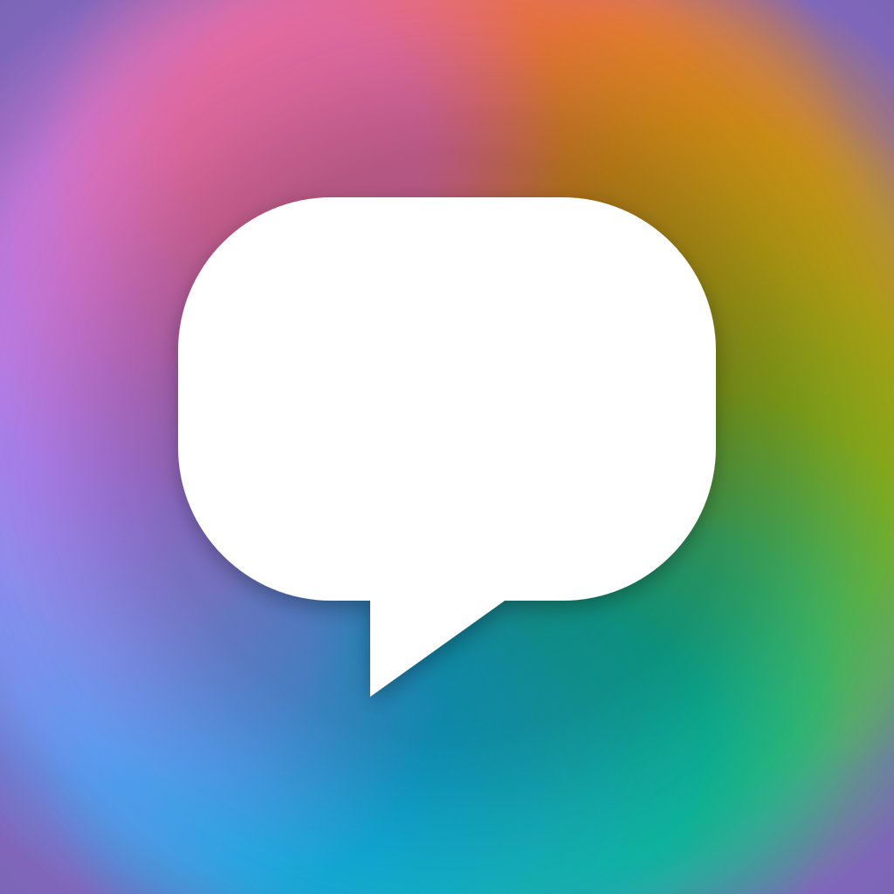

<p align="center">
  
</p>

<h1 align="center">Chirper</h1>

<p align="center">One on-device universal messenger for all your chat networks.</p>

<p align="center">
  <a href="https://github.com/itsrhotaudevvy/chirper/releases/latest"></a>
  <a href="https://github.com/itsrhotaudevvy/chirper/actions/workflows/ci.yml"></a>
  <a href="https://github.com/itsrhotaudevvy/chirper/actions/workflows/codeql.yml"></a>
  <a href="LICENSE"></a>
  <a href="https://v2.tauri.app"></a>
</p>

Chirper signs in to the chat networks you already use and shows them side by side in one app.
It is an on-device universal client built with Tauri v2, Svelte 5, Rust, and Go for **Android, iOS, macOS, Windows, and Linux**.

---

## Downloads & Releases

Pre-compiled release packages are available on the [GitHub Releases](https://github.com/itsrhotaudevvy/chirper/releases/latest) page:

| Platform | Format | Architecture | Download |
|---|---|---|---|
| **Android** | `.apk` (Universal) | ARM64, ARMv7, x86_64 | [chirper_0.1.0_android_universal.apk](https://github.com/itsrhotaudevvy/chirper/releases/latest) |
| **macOS** | `.dmg` Installer | Apple Silicon (aarch64) | [Chirper_0.1.0_macos_aarch64.dmg](https://github.com/itsrhotaudevvy/chirper/releases/latest) |
| **macOS** | `.zip` Portable | Apple Silicon (aarch64) | [Chirper_0.1.0_macos_aarch64.zip](https://github.com/itsrhotaudevvy/chirper/releases/latest) |
| **Windows** | `.msi` / `.exe` | x64 | *Built via CI Release Pipeline* |
| **Linux** | `.AppImage` / `.deb` | x64 | *Built via CI Release Pipeline* |
| **iOS** | `.ipa` / TestFlight | arm64 | *Built via CI Release Pipeline* |

---

## Documentation

Comprehensive technical and user documentation is available in [`docs/`](docs/):

- 📖 **[Getting Started Guide](docs/GETTING_STARTED.md)** — Installation, initial vault setup, pairing accounts, shortcuts.
- 🏗️ **[Architecture Deep Dive](docs/ARCHITECTURE.md)** — Component decomposition, IPC bridge, Go engine, memory flow.
- 🛠️ **[Building & Packaging](docs/BUILDING.md)** — Complete toolchain setup, compiling Go C-ABI, building desktop & mobile packages.
- 🌐 **[Supported Networks Matrix](docs/NETWORKS.md)** — Protocols, pairing flows, E2EE status, media capabilities.
- 🔒 **[Security & Privacy Model](docs/SECURITY_MODEL.md)** — Zero-server guarantees, SQLCipher encryption, OS Keystore integration, CSP.
- 🎨 **[Design System & Tokens](docs/DESIGN.md)** — Color-coded rainbow spectrum, progressive disclosure, typography, motion tokens.
- 📜 **[FFI & IPC Contract](docs/CONTRACT.md)** — Low-level C ABI signatures, JSON schemas, event batching specs.
- 🗺️ **[Development Roadmap](docs/PLAN.md)** — Rewrite specifications, platform integration matrix, performance budgets.

## Why Chirper

- **No server.** There is no Chirper backend. The bridge code runs inside the app and talks only to
  the networks you log in to.
- **Everything on device.** Messages, media and keys live on your device. Keys sit in the OS keystore.
- **13 networks in one inbox.** See [Supported networks](#supported-networks).
- **Colour-coded rainbow design.** Every network has its own colour on one spectrum, so you can tell
  chats apart at a glance. The design rules are in [docs/DESIGN.md](docs/DESIGN.md).

## Supported platforms

| Platform | Packaging | Planned integration (see [docs/PLAN.md](docs/PLAN.md) §4) |
|---|---|---|
| iOS | Xcode build, App Store Connect (`.ipa`) | Background refresh only, no push (there is no server) |
| Android | APK and AAB | Foreground service for sync, `FLAG_SECURE` screen privacy |
| macOS | Universal `.dmg` (Apple silicon and Intel) | Dock badge, Touch ID app lock |
| Windows | `.msi` and NSIS `.exe` | Taskbar badge, Windows Hello app lock |
| Linux | `.AppImage`, `.deb`, `.rpm` | Secret Service keystore, passphrase app lock |

## Supported networks

Bridged with the mautrix bridgev2 connectors (`third_party/`) or the Chirper connectors in
`go/connectors/` (Discord and Fluxer):

Instagram, Messenger, WhatsApp, Signal, Telegram, Discord, Slack, X (Twitter), LinkedIn, Bluesky,
Google Messages, Google Voice, Fluxer.

Each network is an unofficial client built on its web or app protocol. Availability and features
depend on the network. Check the network picker in the app for the current state.

## Architecture

```
┌──────────── Webview (ui/, Svelte 5 + TypeScript + Vite) ────────────┐
│ screens ── stores ── CoreApi (TauriCore | FakeCore for browser dev)  │
└───────────────┬────────────────────────────────▲─────────────────────┘
        invoke(cmd, args)                  event "core-batch" (16 ms batches)
┌───────────────▼────────────────────────────────┴─────────────────────┐
│ src-tauri/ (crate chirper-app): commands, validation, event batching, │
│   platform/{macos,windows,linux,android,ios}.rs, tray, lock, badge    │
│ plugins/chirper-native/: Kotlin + Swift (haptics, keystore,           │
│   foreground service, share target, secure screen, notification reply)│
│ crates/chirper-core/: safe Rust wrapper over the Go C ABI, keystore   │
└───────────────┬──────────────────────────────────────────────────────┘
                │ C ABI (5 functions, JSON envelopes) — docs/CONTRACT.md
┌───────────────▼──────────── go/core (module chirper.dev/core) ───────┐
│ capi/ (cgo exports) → facade/ → engine/ → localmx/ → store/          │
│ connectors: third_party/mautrix-* + go/connectors/{discord,fluxer}   │
└──────────────────────────────────────────────────────────────────────┘
```

The full design is in [docs/PLAN.md](docs/PLAN.md). The binding JSON and FFI contracts are in
[docs/CONTRACT.md](docs/CONTRACT.md).

## Build from source

### Prerequisites

- **Rust 1.85 or newer** (`rust-toolchain.toml` selects the stable channel and the targets)
- **Go 1.27**
- **Node.js 22 or newer** and **pnpm**
- **Tauri prerequisites** for your OS, see <https://v2.tauri.app/start/prerequisites/>
  - Linux: `libwebkit2gtk-4.1-dev libayatana-appindicator3-dev librsvg2-dev libsecret-1-dev patchelf`
    (plus the packages listed in the Tauri guide)
  - macOS: Xcode command line tools. Windows: MSVC build tools and MinGW (`msys2`, for cgo)
- **Android:** Android SDK and NDK `28.2.13676358`, `JAVA_HOME` pointing to JDK 21
- **iOS:** full Xcode (iOS builds run on macOS only)

### Steps

```sh
# 1. Clone the pinned connector sources into third_party/ (gitignored)
scripts/fetch-third-party.sh

# 2. Install UI dependencies
pnpm -C ui install

# 3. Build the Go core for your target triple (for example aarch64-apple-darwin)
scripts/build-go.sh aarch64-apple-darwin

# 4. Run the desktop app in development, or build a release bundle
cargo tauri dev
cargo tauri build
```

Mobile:

```sh
cargo tauri android dev
cargo tauri ios dev
```

Run `scripts/build-go.sh` for each mobile triple before you build for that platform.

### Tests and checks

```sh
cargo fmt --all --check
cargo clippy --workspace --all-targets --features chirper-core/mock -- -D warnings
cargo test --workspace --features chirper-core/mock
(cd go/core && go vet ./... && go test -race ./...)
pnpm -C ui check && pnpm -C ui test
```

## Privacy

Chirper has no telemetry, no crash reporting and no analytics. Your data is stored on your device,
and the only outbound traffic goes to the networks you log in to. Read [PRIVACY.md](PRIVACY.md) for the
full list of what is stored where.

## Security

Report vulnerabilities privately through GitHub Security Advisories. See [SECURITY.md](SECURITY.md).

## Contributing

Read [CONTRIBUTING.md](CONTRIBUTING.md) for the dev setup, repository layout, code style and the PR
checklist. This project follows the [Code of Conduct](CODE_OF_CONDUCT.md).

## License

Chirper is free software licensed under the [GNU Affero General Public License v3.0 or later](LICENSE).
